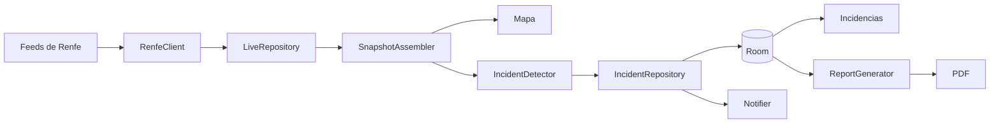

# Arquitectura

Un solo módulo Android con Kotlin, Compose y Material 3, sin backend ni cuentas. Sigue el estilo de los demás proyectos: inyección manual (`AppContainer`) y dependencias en `gradle/libs.versions.toml`.

## Flujo de datos

`AppContainer.collect()` es el ciclo completo y lo usan dos actores:

- **Con la app visible:** `AppViewModel.pollWhileVisible()`, cada 15, 30 o 60 segundos.
- **En segundo plano:** `CollectWorker`, cada 15 minutos, que además genera los informes pendientes.

## Código

| Paquete | Responsabilidad |
|---|---|
| `data/remote` | Esquema GTFS Realtime y descarga |
| `data/local` | Room: incidencias, muestras e informes. El esquema se exporta a `app/schemas` |
| `data` | Repositorios, ajustes, mapa offline y almacenamiento |
| `domain` | Lógica pura sin Android: clasificación, detección, salud y agregación. Es lo más probado |
| `report` | Dibujo y generación de los PDF |
| `work` | Recogida periódica y notificaciones |
| `ui` | Pantallas Compose: mapa, incidencias, informes y ajustes |

## Decisiones

**Sin backend en el MVP.** No genera costes, no pide cuentas y no recoge datos de nadie. A cambio, cada móvil solo sabe lo que observa, lo que tiene dos consecuencias importantes:

- Android limita las tareas periódicas a un mínimo de 15 minutos y puede espaciarlas, así que **una alerta en segundo plano puede llegar con más de 15 minutos de retraso**.
- Los informes tienen huecos si el móvil estuvo apagado o sin red. Por eso indican su cobertura.

Un servidor con recogida continua y notificaciones push resolvería ambas cosas, y es el principal salto pendiente ([hoja de ruta](hoja-de-ruta.md)).

**Protobuf con `kotlinx-serialization`.** Reduce el consumo a un tercio frente a JSON sin plugin de generación de código. Los enums se guardan como `Int` para que un valor nuevo no rompa la decodificación.

**La urgencia máxima se conserva.** Una incidencia guarda la peor severidad alcanzada, y se vuelve a notificar solo si empeora.

**Cada fuente solo cierra lo que pudo ver.** Una descarga fallida no significa que la incidencia terminó, así que no resuelve nada (`IncidentRepository.record`).

**MapLibre con OpenFreeMap.** Es abierto, gratuito y sin clave. Se usa el estilo `liberty` en ambos temas para que el mapa guardado sirva siempre.

**Mapa offline hasta zoom 8.** Zoom 9 serían 1.404 teselas pero midió 58 MB, por encima del límite de 50 MB de OpenFreeMap. Zoom 8 son 384 teselas y 31 MB. Ampliarlo requiere pedirles permiso o alojar las teselas.

**Paleta fija.** Sin color dinámico, para que la urgencia se vea igual en todos los móviles.

**Inglés por defecto en `values/`, español en `values-es/`.** Los avisos de Renfe no se traducen: enviar el texto a un tercero complicaría la privacidad, así que en inglés se marcan como "in Spanish".

**Idioma.** Se aplica solo cuando se elige en Ajustes, para respetar también el idioma por app de Android. Workers y notificaciones usan `localized()` porque corren fuera de una actividad.

## Retención y consumo

- Incidencias y muestras se conservan 2 años, y después se borran.
- Los PDF se conservan hasta que el usuario los borra.
- Una muestra ocupa unas decenas de bytes; un año son unas 35.000 filas.
- Con la app abierta a 30 segundos, el consumo teórico máximo es de unos 13 MB por hora. Es menor en la práctica, porque un feed sin cambios se resuelve con `304`. No se ha medido en un móvil real.
- En segundo plano son unos 10 MB al día como máximo.

## Tamaño de la APK

La APK de depuración pesa 71 MB porque incluye MapLibre para todas las arquitecturas. Publicar como Android App Bundle reparte solo la necesaria. Los idiomas no se dividen en el bundle, porque el selector de Ajustes necesita los dos instalados.
